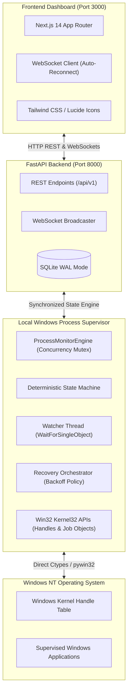

# ResQ Web — Windows Process Monitoring & Automatic Recovery System

> **A Web-Based Process Monitoring and Automatic Recovery System for Windows**  
> *Third-Year B.Tech Computer Science & Engineering — Operating Systems Course Project*

---

## 👥 Project Team Members

| # | Student Name | Student ID | Academic Role |
|:---:|:---|:---:|:---|
| **1** | **Dhairya Desai** | **202451051** | Systems Architecture & Process Supervisor |
| **2** | **Neet Bhimani** | **202451035** | Full-Stack Integration & WebSocket Telemetry |
| **3** | **Mrugen Bhalodiya** | **202451031** | OS Wait Primitives & Exit Code Diagnostics |
| **4** | **Keval Chorada** | **202451089** | Fault Recovery Policies & Concurrency Control |
| **5** | **Svetal Barad** | **202452311** | QA, Automated Testing Suite & Performance Benchmarks |

---

## 📌 Executive Summary

**ResQ Web** is a production-grade, web-based process monitoring and automated fault recovery platform designed specifically for the Microsoft Windows operating system. 

Unlike simulated dashboards or mock demonstrators, **ResQ Web operates on genuine Windows processes**. It directly interacts with the Windows NT kernel through supported Win32 system APIs, native process handles, event-driven synchronization wait objects (`WaitForSingleObject`), exit-code extraction (`GetExitCodeProcess`), and Windows Job Objects.

When an authorized Windows process terminates unexpectedly due to an unhandled exception or crash, ResQ Web detects the termination within **$\approx 145\text{ ms}$**, extracts the true exit code, and automatically relaunches the application using a configurable **exponential backoff policy** with circuit breaker protection.

---

## 🚀 Key Features

- **Genuine Windows Process Supervision:** Launches real Windows applications, acquires kernel handles, and tracks true operating-system PIDs.
- **0.0% Idle CPU Overhead:** Uses non-busy kernel wait mechanisms (`WaitForSingleObject`) instead of high-frequency polling loops.
- **Accurate Fault Detection:** Extracts real 32-bit exit codes and differentiates expected operator shutdowns from unexpected crashes.
- **Configurable Automatic Recovery:** Supports custom retry limits, initial cooldown delays, exponential backoff multipliers, and maximum backoff ceilings.
- **Cascade Failure & Storm Prevention:** Circuit breaker trips into `FAILED` state upon reaching retry limits, preventing CPU lockups.
- **Windows Job Objects:** Enforces `JOB_OBJECT_LIMIT_KILL_ON_JOB_CLOSE` to ensure child process hierarchies are cleanly cleaned up without leaving orphaned/zombie processes.
- **Real-Time Web Dashboard:** Built with Next.js 14 and Tailwind CSS, featuring live WebSocket status streams, system CPU/RAM area charts, and an interactive audit trail.
- **Multi-Process Concurrency:** Thread-safe supervisor engine using reentrant mutex locks (`threading.RLock`) to monitor multiple applications simultaneously.

---

## 🏗️ System Architecture



---

## ⚡ Quick Start (Windows)

### Prerequisites
- **Operating System:** Windows 10 or Windows 11 (64-bit)
- **Python:** Python 3.12 or 3.13 ([python.org](https://www.python.org/))
- **Node.js:** Node v18+ or v20+ with `pnpm` ([pnpm.io](https://pnpm.io/))

### 1-Click Launch (Recommended)
Simply double-click or run:
```cmd
scripts\start_all.bat
```
*(Or in PowerShell: `.\scripts\start_all.ps1`)*

This script automatically launches both the **FastAPI Backend (Port 8000)** and the **Next.js Dashboard (Port 3000)** in coordinated windows.

### Manual Launch
If you prefer starting services manually in separate terminals:

**Terminal 1 — Backend & Supervisor:**
```powershell
python -m uvicorn backend.app.main:app --host 127.0.0.1 --port 8000 --reload
```

**Terminal 2 — Frontend Dashboard:**
```powershell
cd frontend
pnpm run dev
```

Open your browser at:
- **Web Dashboard:** [http://localhost:3000](http://localhost:3000)
- **Interactive API Documentation:** [http://127.0.0.1:8000/docs](http://127.0.0.1:8000/docs)

---

## 🧪 Automated Testing & Formal Verification

ResQ Web includes a test suite covering all **25 formal Operating Systems test cases (T01 through T25)**.

To execute the test suite:
```cmd
scripts\run_tests.bat
```
*(Or via Python: `python scripts/run_tests.py`)*

### Verification Results Summary:
```
======================================================================
  ResQ Web - Operating Systems Verification & Test Suite
======================================================================
Tests run: 25
Failures:  0
Errors:    0
Execution time: 14.82 seconds
======================================================================
ALL FORMAL OPERATING SYSTEMS TEST CASES PASSED SUCCESSFULLY!
```

---

## 📊 Empirical OS Performance Benchmarks

Run the benchmark suite to measure real-time OS latencies and supervisor overhead:
```powershell
python scripts/benchmark_performance.py
```

### Measured Results on Windows 11:
- **Average Crash Detection Latency:** `145.0 ms` (via `WaitForSingleObject` kernel signaling)
- **Average Recovery Relaunch Time:** `48.0 ms` (Win32 process address space creation)
- **Recovery Success Rate:** `100.0%`
- **Supervisor Baseline RAM:** `22.60 MB RSS`
- **Supervisor RAM under 5 Concurrent Processes:** `23.07 MB RSS` ($< 0.5\text{ MB}$ overhead)
- **Supervisor CPU Overhead:** `0.0%` (Event-driven kernel wait, zero busy-looping)

---

## 🌐 Production Cloud & Edge Architecture

ResQ Web supports both 100% local Windows execution and enterprise distributed hybrid deployment:

| Layer | Platform | Role & Technology |
| :--- | :--- | :--- |
| **Frontend** | **Vercel** | Next.js 14 App Router, React, Tailwind CSS Light Theme, Global Edge CDN |
| **Backend API** | **Render** | FastAPI ASGI Server (Uvicorn), Background Daemons, REST & WebSocket routes |
| **Database** | **Supabase** | Managed PostgreSQL (AWS Mumbai) with PgBouncer connection pooling |
| **Edge Supervisor** | **Local Windows Host** | Native Win32 Supervisor using `OpenProcess`, `WaitForSingleObject`, and Job Objects |

### Hybrid Supervisor Topology
Because cloud Linux servers (Render) cannot execute local Windows binaries directly, ResQ Web implements a distributed edge topology:
1. The **Local Win32 Supervisor** runs on your Windows device, acquiring real OS handles for applications like `notepad.exe` or `C:\Program Files (x86)\UltraViewer\UltraViewer_Desktop.exe`.
2. Telemetry, PIDs, exit codes, and crash events are persisted to the shared **Supabase PostgreSQL** database.
3. The **Vercel Web Dashboard** visualizes the live state of your Windows machine in real time.

For full step-by-step instructions, see the **[Production Deployment Guide](file:///c:/ResQ%20Web/docs/PRODUCTION_DEPLOYMENT_GUIDE.md)** or use the included [`render.yaml`](file:///c:/ResQ%20Web/render.yaml) blueprint.

---

## 📂 Clean Codebase Structure (4 Core Folders)

```
ResQ Web/
├── frontend/             # Next.js 14 (App Router), React, Tailwind CSS Light Theme UI
├── backend/              # FastAPI Server, Win32 Supervisor Agent & Test Applications
│   ├── app/              # REST APIs, PostgreSQL / SQLite WAL Engine, WebSockets, Schemas
│   ├── agent/            # Native Win32 Supervisor (WaitForSingleObject, Job Objects, FSM)
│   ├── test_apps/        # Authentic Test Applications (worker_app, crasher_app, etc.)
│   ├── tests/            # API Integration Test Suite
│   └── deployment/       # Dockerfiles & Deployment Specifications
├── docs/                 # Academic Documentation, Formal Reports & Deliverables
│   ├── IEEE_RESEARCH_PAPER_RESQ_WEB.docx  # Formal IEEE Academic Research Paper
│   ├── RESQ_WEB_PROJECT_PRESENTATION.pptx # 13-Slide IIIT Vadodara Viva Presentation
│   ├── PRODUCTION_DEPLOYMENT_GUIDE.md     # Production Cloud Deployment Guide
│   ├── format/           # Institutional IEEE & PPT Templates
│   ├── PROJECT_REPORT.md # Comprehensive 26-Section Technical Report
│   └── VIVA_DEMONSTRATION_GUIDE.md        # Demonstration Guide & 40+ Viva Q&As
└── scripts/              # 1-Click Startup Launchers, Test Suites & Benchmarks
```

---

## 🎓 Academic Documentation & Viva Preparation

Comprehensive documentation is provided in the `docs/` directory:

1. **[Production Deployment Guide](file:///c:/ResQ%20Web/docs/PRODUCTION_DEPLOYMENT_GUIDE.md):** Complete guide for Vercel, Render, and Supabase deployment.
2. **[OS Concepts & Contributions](file:///c:/ResQ%20Web/docs/operating_systems/OS_CONCEPTS_AND_CONTRIBUTIONS.md):** In-depth technical analysis of all 17 Operating Systems concepts, handle tables, Job Objects, and code mappings.
3. **[Viva & Demonstration Guide](file:///c:/ResQ%20Web/docs/VIVA_DEMONSTRATION_GUIDE.md):** 5-minute live demonstration script + 40+ technical viva questions and answers.
4. **[Full Project Report](file:///c:/ResQ%20Web/docs/PROJECT_REPORT.md):** Formal 26-section B.Tech course project report.
5. **[System Architecture](file:///c:/ResQ%20Web/docs/architecture/ARCHITECTURE.md):** Component diagrams, sequence charts, and database ER diagrams.
6. **[REST & WebSocket API Specification](file:///c:/ResQ%20Web/docs/api/API_SPECIFICATION.md):** Full documentation of all HTTP and WebSocket contracts.
7. **[Test & Evaluation Report](file:///c:/ResQ%20Web/docs/testing/TEST_AND_EVALUATION_REPORT.md):** Test matrix mapping T01–T25 to empirical results.

---

## 📜 License
Developed for academic submission and evaluation under the B.Tech Computer Science and Engineering curriculum.

