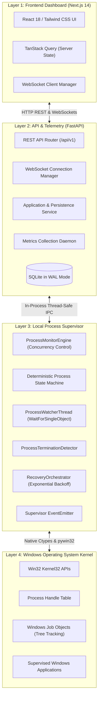
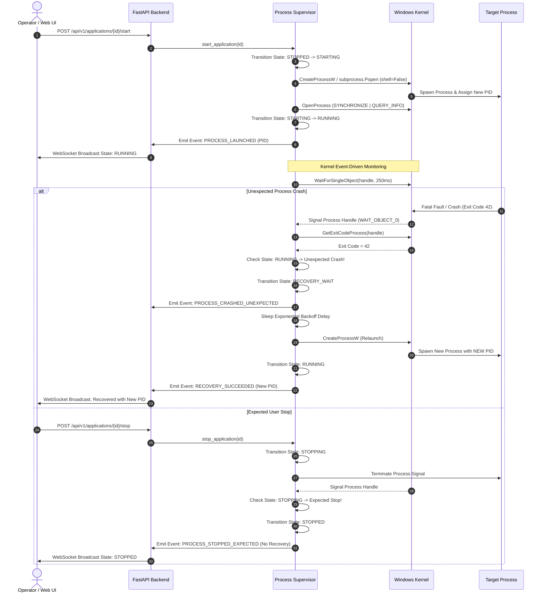
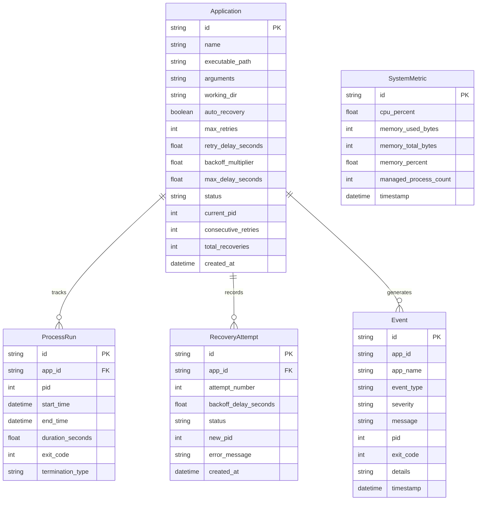

# ResQ Web — System Architecture Specification

## 1. Architectural Overview

ResQ Web is built as a layered, fault-tolerant process supervision and automatic recovery platform for Windows. It provides strict isolation between user interface presentation, API validation, state persistence, and native Windows operating system calls.

---

## 2. Component Descriptions

### Layer 1: Frontend Dashboard (Next.js 14 App Router)
- **Role:** Centralized developer operations interface for operators.
- **Tech Stack:** Next.js 14, React 18, TypeScript, Tailwind CSS, Lucide React, TanStack Query v5, Recharts.
- **Key Modules:**
  - `app/page.tsx`: System overview, KPI cards, real-time metrics, active applications table, recent event feed.
  - `app/applications/page.tsx`: Application inventory, state filtering, full lifecycle actions (Launch, Stop, Restart, Delete).
  - `app/applications/[id]/page.tsx`: Telemetry deep dive, per-process CPU/RAM footprint, thread counts, OS handle counts, historical process run log.
  - `app/recovery/page.tsx`: Backoff policy controls, interactive simulator, recovery attempt logs.
  - `app/system/page.tsx`: System-wide CPU and RAM area charts, per-process resource breakdown.
  - `app/analytics/page.tsx`: Empirical MTTR, crash detection latency, recovery success rate analytics.
  - `app/logs/page.tsx`: Filterable, searchable diagnostic log viewer.
  - `app/settings/page.tsx`: Component health statuses, academic team credits.

### Layer 2: Backend API & Telemetry (FastAPI)
- **Role:** Validates operator requests, enforces authorization boundaries, persists state and audit history, and broadcasts real-time telemetry.
- **Tech Stack:** Python 3.12/3.13, FastAPI, Pydantic v2, SQLAlchemy 2.0 with SQLite WAL mode.
- **Key Services:**
  - `ApplicationService`: Synchronizes database entities with the supervisor engine's memory state.
  - `EventService`: Subscribes to the supervisor's event bus and persists audit logs.
  - `MetricsCollectorService`: Background thread that samples CPU, RAM, and process counts every 2 seconds.
  - `ConnectionManager`: Multi-client WebSocket broadcaster.

### Layer 3: Local Windows Process Supervisor
- **Role:** The core Operating Systems engine that interfaces with the Windows NT executive.
- **Key Modules:**
  - `ProcessLauncher`: Validates binary paths, prevents path traversal, and executes processes using `shell=False`.
  - `ProcessHandle`: RAII wrapper for native Windows handles (`OpenProcess`, `CloseHandle`).
  - `JobObject`: Win32 Job Object wrapper enforcing `JOB_OBJECT_LIMIT_KILL_ON_JOB_CLOSE`.
  - `ProcessWatcherThread`: Asynchronous background thread executing non-busy `WaitForSingleObject` kernel waits.
  - `ProcessTerminationDetector`: Distinguishes expected user-initiated stops from unexpected crashes.
  - `RecoveryOrchestrator`: Coordinates exponential backoff delays, retry limits, and relaunches with thread-safe locking.
  - `ProcessStateMachine`: Enforces deterministic state transitions.

---

## 3. Process Lifecycle Sequence Diagram

---

## 4. Database Schema (Entity-Relationship)

